# 2. Casos de uso

[← Índice](README.md)

## 2.1 Diagrama general

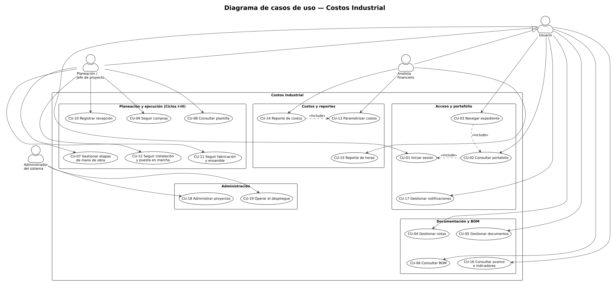

## 2.2 Actores

| Actor | Descripción | Relación |
|---|---|---|
| **Usuario** | Cualquier persona autenticada en el aplicativo. Consulta el portafolio, los expedientes, la documentación, la BOM, los reportes de avance e indicadores, y gestiona sus notificaciones. | Actor base |
| **Planeación / Jefe de proyecto** | Planea y hace seguimiento a la ejecución: etapas de mano de obra, plantilla base, compras, recepción, fabricación, ensamble, instalación y pruebas. | Especializa a *Usuario* (RE-040) |
| **Analista financiero** | Define los parámetros económicos del proyecto y analiza los reportes de costos y de horas. | Especializa a *Usuario* (RE-040) |
| **Administrador del sistema** | Da de alta y mantiene los proyectos; despliega, respalda y restaura el aplicativo. | Independiente |

## 2.3 Resumen y estado de implementación

**Leyenda de estado**

- ✅ **Completo**: implementado en la interfaz y en el API.
- 🟡 **Consulta en UI**: la interfaz solo consulta; las altas, cambios y bajas existen en el API (`/docs`) pero aún no tienen formulario en la interfaz.
- 🔧 **Solo API**: no hay pantalla; se opera con el API.
- ⚪ **Simulado**: comportamiento de demostración.

| ID | Caso de uso | Actor principal | Requerimientos | Estado |
|---|---|---|---|---|
| CU-01 | Iniciar sesión | Usuario | RE-039, RE-040 | ⚪ Simulado |
| CU-02 | Consultar portafolio de proyectos | Usuario | RE-001 | ✅ Completo |
| CU-03 | Navegar expediente de proyecto | Usuario | RE-001 | ✅ Completo |
| CU-04 | Gestionar notas del proyecto | Usuario | RE-001 (soporte) | ✅ Completo |
| CU-05 | Gestionar documentos del proyecto | Usuario | RE-001 (soporte) | ✅ Completo* |
| CU-06 | Consultar lista de materiales (BOM) | Usuario | RE-003 a RE-007, RE-029 | 🟡 Consulta en UI |
| CU-07 | Gestionar etapas de mano de obra | Planeación | RE-011 a RE-014 | 🟡 Consulta en UI |
| CU-08 | Consultar plantilla base aplicada | Planeación | RE-002 | 🟡 Consulta en UI |
| CU-09 | Seguir compras | Planeación | RE-008, RE-009, RE-010 | 🟡 Consulta en UI |
| CU-10 | Registrar recepción de materiales | Planeación | RE-029 (soporte) | 🟡 Consulta en UI |
| CU-11 | Seguir fabricación y ensamble | Planeación | Ciclo II | 🟡 Consulta en UI |
| CU-12 | Seguir instalación y puesta en marcha | Planeación | Ciclo III | 🟡 Consulta en UI |
| CU-13 | Parametrizar costos del proyecto | Analista financiero | RE-019 a RE-021, RE-024 a RE-026, RE-033 | 🔧 Solo API |
| CU-14 | Generar reporte de costos | Analista financiero | RE-029 a RE-036 | ✅ Completo |
| CU-15 | Generar reporte de horas | Analista financiero | RE-037, RE-015 | ✅ Completo |
| CU-16 | Consultar avance e indicadores | Usuario | RE-036, RE-037 | ✅ Completo |
| CU-17 | Gestionar notificaciones | Usuario | RE-040 | ✅ Completo |
| CU-18 | Administrar proyectos | Administrador | RE-001 | 🔧 Solo API |
| CU-19 | Operar el despliegue | Administrador | RE-039 | ✅ Completo (Makefile) |

\* Los archivos adjuntos (Word/Excel) guardan solo los metadatos; el contenido binario todavía no se sube al servidor.

Fuera de alcance en esta versión: **RE-006** (tipificación de consumos), **RE-027 / RE-038** (comparación entre lo estimado y lo real) y **RE-028** (calibración). El reporte de costos lo indica con `actualCostAvailable = false`.

---

## 2.4 Especificación de casos de uso

Cada caso de uso tiene su ficha y su diagrama de secuencia. En las secuencias, «FastAPI» es `backend/app/routers/api.py` y «BD» es SQLite (desarrollo) o PostgreSQL (Docker). En desarrollo, las peticiones `/api` pasan por el proxy de `ng serve`; en despliegue, por Nginx.

### CU-01 Iniciar sesión

| Campo | Detalle |
|---|---|
| **Actor** | Usuario |
| **Objetivo** | Entrar al aplicativo. |
| **Precondiciones** | El aplicativo está desplegado y accesible (RE-039). |
| **Disparador** | El usuario abre la raíz `/`. |
| **Flujo principal** | 1. El sistema muestra el formulario de acceso (correo y contraseña). 2. El usuario ingresa sus datos y pulsa **INGRESAR AL SISTEMA →**. 3. El sistema marca la sesión como iniciada. 4. El sistema redirige a `/app/proyectos` (CU-02). |
| **Flujos alternos** | 2a. El usuario pulsa el ícono del ojo para mostrar u ocultar la contraseña. |
| **Postcondiciones** | `AuthService.isLoggedIn$ = true`; el menú de usuario muestra «Andrea M. — Financiero». |
| **Reglas / notas** | **Simulado:** no se validan credenciales ni se consulta el backend; las rutas `/app/**` no tienen guard. Para pasar a producción hace falta un endpoint `/api/auth/login` y un guard de rutas. |

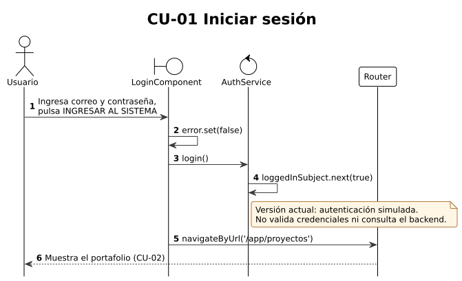

### CU-02 Consultar portafolio de proyectos

| Campo | Detalle |
|---|---|
| **Actor** | Usuario |
| **Objetivo** | Ver todos los expedientes, su estado y avance, y el calendario de hitos. |
| **Precondiciones** | CU-01 realizado. |
| **Flujo principal** | 1. El usuario entra a **EXPEDIENTES ACTIVOS**. 2. El sistema consulta `GET /api/projects` y `GET /api/projects/calendar`. 3. El sistema muestra una tarjeta por proyecto (código, sello de estado, nombre, familia, barra de avance, responsable) y el calendario mensual con los eventos. 4. El usuario abre un proyecto desde la tarjeta o desde el calendario (CU-03). |
| **Flujos alternos** | 3a. No hay proyectos: se muestra «No hay expedientes activos». 4a. El usuario pulsa **+ NOTA** en una tarjeta: se abre el modal de notas (CU-04). 4b. El usuario cambia de mes con las flechas del calendario. |
| **Postcondiciones** | Ninguna (consulta). |
| **Reglas / notas** | Los indicadores de la franja superior (proyectos activos, horas, costo comprometido, próximo corte) todavía son texto fijo en la plantilla. |

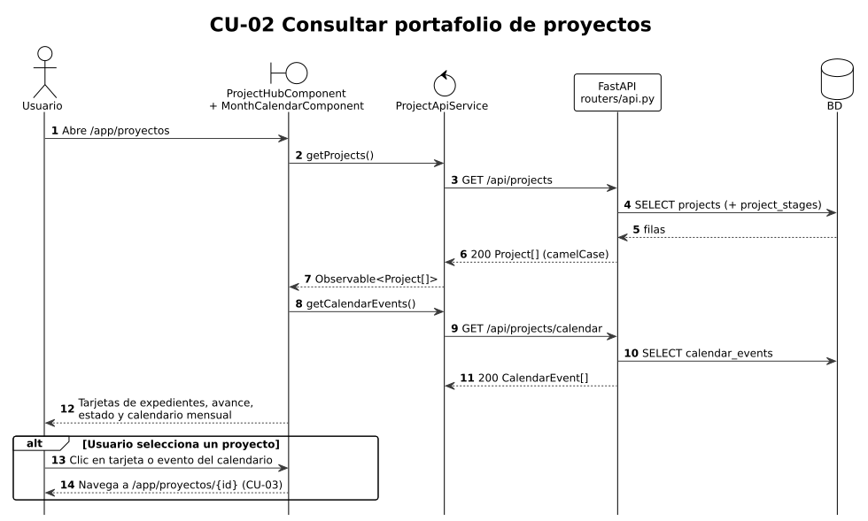

### CU-03 Navegar expediente de proyecto

| Campo | Detalle |
|---|---|
| **Actor** | Usuario |
| **Objetivo** | Recorrer las hojas del expediente organizadas por ciclo. |
| **Precondiciones** | El proyecto existe. |
| **Flujo principal** | 1. El usuario abre `/app/proyectos/{id}`. 2. El sistema consulta `GET /api/projects/{id}`. 3. El sistema carga la plantilla de navegación del proyecto (`navTemplate`): CICLO I, CICLO II, CICLO III, REPORTES y CONFIGURACIÓN, con sus hojas numeradas de 01 a 19. 4. El usuario elige ciclo y hoja; el sistema muestra la página correspondiente y la refleja en la URL. |
| **Flujos alternos** | 2a. El proyecto no existe: el API responde 404 y el expediente queda vacío. 4a. En móvil, el menú se abre con el botón de hamburguesa. |
| **Postcondiciones** | Se muestra la página de la hoja elegida. |
| **Reglas / notas** | La hoja por defecto es `documentacion`. Las hojas de CONFIGURACIÓN (datos, usuarios, permisos) todavía son marcadores sin contenido. **Limitación conocida:** al entrar por URL directa a una hoja (p. ej. `…/costos`), el menú sigue resaltando CICLO I › 01, aunque el contenido es el correcto. |

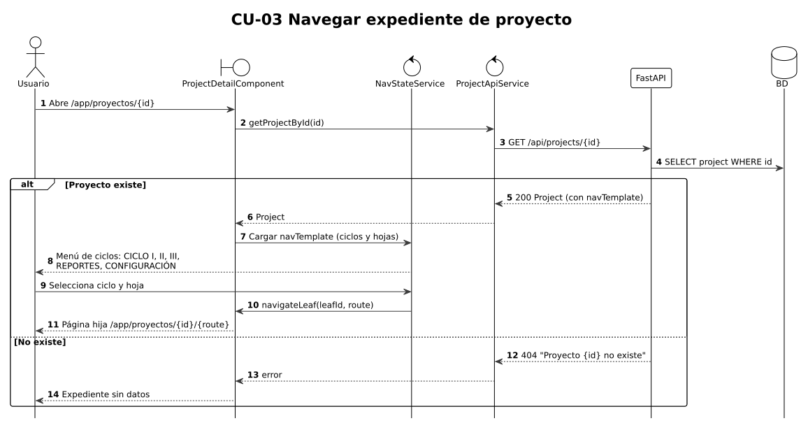

### CU-04 Gestionar notas del proyecto

| Campo | Detalle |
|---|---|
| **Actor** | Usuario |
| **Objetivo** | Registrar notas rápidas en Markdown asociadas a una fecha del proyecto. |
| **Precondiciones** | Proyecto abierto (hoja 01) o tarjeta visible en el portafolio. |
| **Flujo principal** | 1. El sistema lista las notas (`GET /projects/{id}/notes`). 2. El usuario pulsa **+ NOTA** o abre una existente. 3. El sistema abre el modal con fecha y contenido. 4. El usuario escribe y pulsa **GUARDAR**. 5. Si es nueva, se crea con `POST`; si existe, se actualiza con `PATCH /notes/{id}`. 6. El sistema cierra el modal y actualiza la lista. |
| **Flujos alternos** | 4a. Contenido vacío: guardar equivale a eliminar la nota. 4b. **ELIMINAR**: `DELETE /notes/{id}`. 4c. El usuario cierra el modal sin guardar: no hay cambios. |
| **Postcondiciones** | La nota queda persistida (o eliminada). |
| **Reglas / notas** | Hay una nota por proyecto y fecha (el modal reutiliza la nota existente de esa fecha). Desde la hoja de documentación, una nota nueva toma la fecha de hoy. |

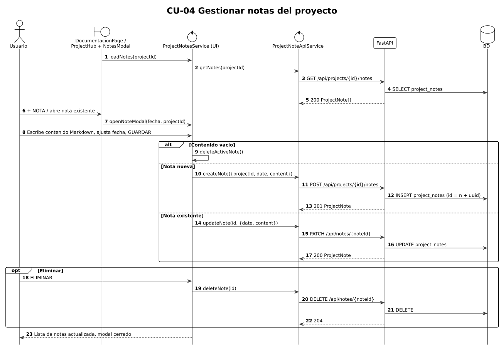

### CU-05 Gestionar documentos del proyecto

| Campo | Detalle |
|---|---|
| **Actor** | Usuario |
| **Objetivo** | Crear, editar, consultar y eliminar documentos del expediente (Markdown o archivos). |
| **Precondiciones** | Proyecto abierto en la hoja 01 NOTAS & DOCUMENTACIÓN. |
| **Flujo principal** | 1. El sistema lista los documentos. 2. El usuario pulsa **NUEVO** o selecciona un documento. 3. Edita el título y el contenido Markdown, y alterna entre edición y vista previa. 4. Pulsa **GUARDAR**: el sistema crea (`POST`) o actualiza (`PATCH /documents/{id}`) con la fecha de actualización. |
| **Flujos alternos** | 2a. **Subir archivo** (Word/Excel): se crea un documento de tipo `file` con nombre, tipo MIME y URL local. 3a. Título vacío: se guarda como «Sin título». 4a. Eliminar: `DELETE /documents/{id}`; si era el seleccionado, el editor se limpia. |
| **Postcondiciones** | El documento queda persistido con `updatedAt` actualizado. |
| **Reglas / notas** | El Markdown se renderiza con `markdown-it` y se sanitiza con DOMPurify. Los archivos usan una URL `blob:` temporal y su binario no se envía al servidor. |

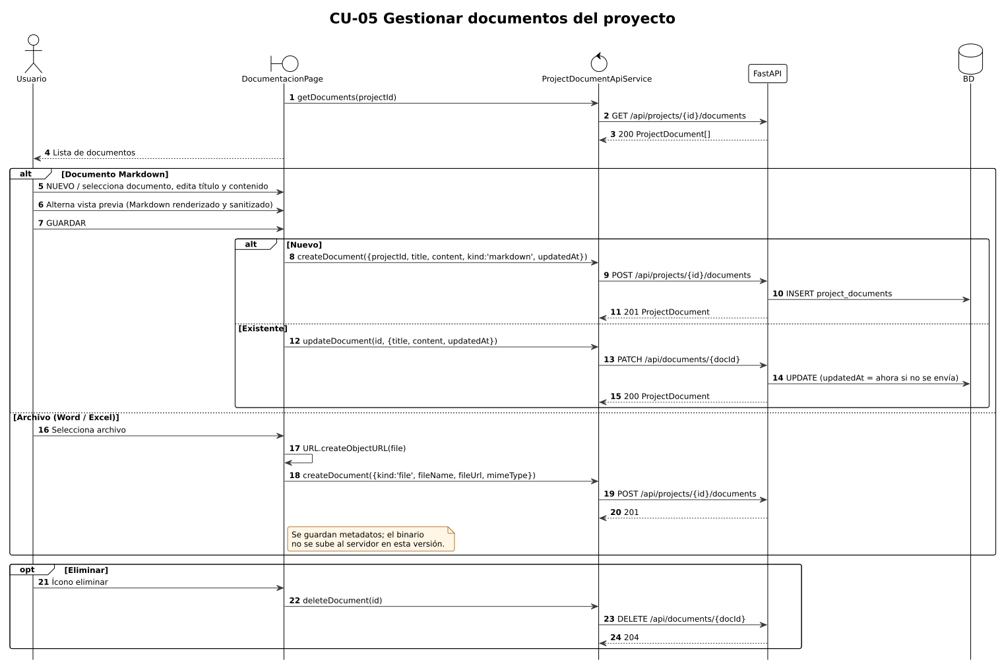

### CU-06 Consultar lista de materiales (BOM)

| Campo | Detalle |
|---|---|
| **Actor** | Usuario |
| **Objetivo** | Ver los componentes del tablero con proveedor, tipo de cálculo, cantidad y costo. |
| **Precondiciones** | Proyecto abierto. |
| **Flujo principal** | 1. El usuario abre la hoja 02. 2. El sistema consulta `GET /projects/{id}/bom`. 3. El sistema muestra la tabla de componentes y, en las filas ESTIMADO, la nota metrológica con el criterio de aproximación. |
| **Flujos alternos** | 3a. Mantenimiento por API: `POST/PATCH/DELETE /projects/{id}/bom[/{itemId}]` con validación de `calcType ∈ {EXACTO, ESTIMADO}`. |
| **Postcondiciones** | Ninguna (consulta). |
| **Reglas / notas** | RE-004 (exacto) y RE-005 (estimado) se distinguen por `calcType`. Los precios se guardan como texto con formato (`$ 1,240.00`); el reporte de costos los convierte a número. Los botones IMPRIMIR y EXPORTAR todavía no hacen nada. |

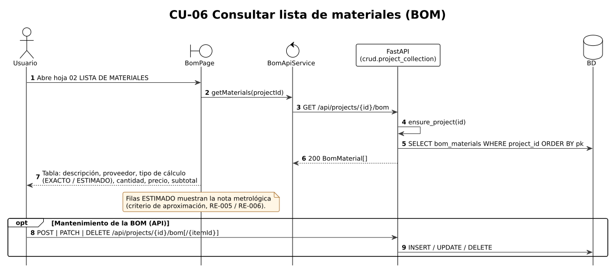

### CU-07 Gestionar etapas de mano de obra

| Campo | Detalle |
|---|---|
| **Actor** | Planeación |
| **Objetivo** | Definir etapas, horas estimadas y valor hora, y conocer el costo de mano de obra. |
| **Precondiciones** | Proyecto abierto. |
| **Flujo principal** | 1. El usuario abre la hoja 03. 2. El sistema consulta `GET /projects/{id}/labor-stages`. 3. El sistema muestra cada etapa con horas, valor hora, costo (= horas × valor hora), responsable y estado, junto con el total. |
| **Flujos alternos** | 3a. Alta, cambio o baja por API. Un estado fuera de {PENDIENTE, EN PROCESO, COMPLETADO} se rechaza con **422**. |
| **Postcondiciones** | Los cambios se reflejan en CU-14, CU-15 y CU-16. |
| **Reglas / notas** | Etapas sugeridas por RE-011: entendimiento del problema, diseño, fabricación, configuración, instalación y calibración. |

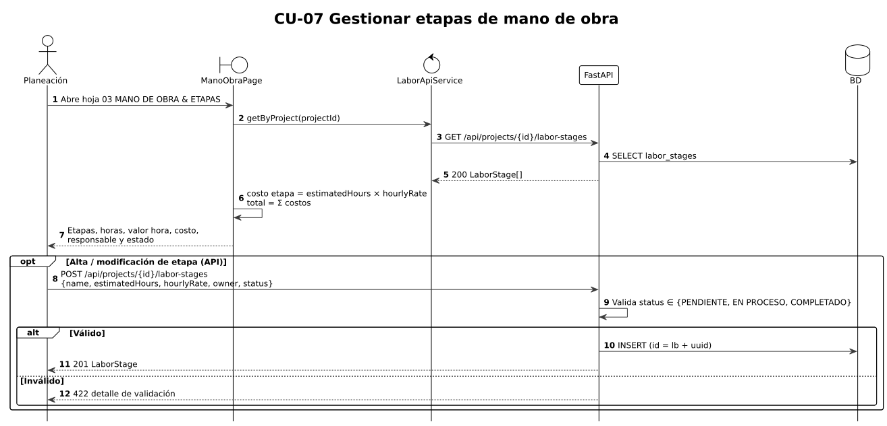

### CU-08 Consultar plantilla base aplicada

| Campo | Detalle |
|---|---|
| **Actor** | Planeación |
| **Objetivo** | Saber de qué plantilla de tablero partió el proyecto y qué bloques se modificaron. |
| **Precondiciones** | Proyecto abierto. |
| **Flujo principal** | 1. El usuario abre la hoja 04. 2. El sistema consulta `GET /projects/{id}/template`. 3. El sistema muestra nombre, versión, familia, autor, fecha de aplicación, estado (VIGENTE / BORRADOR / HISTÓRICA) y los bloques heredados, marcando los modificados. |
| **Flujos alternos** | 2a. El proyecto no tiene plantilla: el API responde `null` y la página muestra el estado vacío. |
| **Postcondiciones** | Ninguna (consulta). |
| **Reglas / notas** | RE-002: la plantilla es un punto de partida modificable (`overridden = true`). |

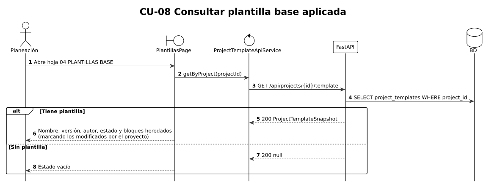

### CU-09 Seguir compras

| Campo | Detalle |
|---|---|
| **Actor** | Planeación |
| **Objetivo** | Controlar las solicitudes y órdenes de compra con su precio neto y lo recibido. |
| **Precondiciones** | Proyecto abierto. |
| **Flujo principal** | 1. El usuario abre la hoja 05. 2. El sistema consulta `GET /projects/{id}/procurement`. 3. El sistema calcula el precio neto, el valor solicitado y el valor recibido, y muestra cada ítem con proveedor, cotización, descuento, cantidades, estado y fecha esperada. |
| **Flujos alternos** | 3a. Actualizar el estado o la cantidad recibida por API (`PATCH`). |
| **Postcondiciones** | Las compras con estado distinto de COMPLETO cuentan como «Compras pendientes» en CU-16. |
| **Reglas / notas** | Precio neto = precio unitario × (1 − descuento / 100) (RE-009, RE-010). Estados en la [sección 7.4](07-manual-funcional.md#74-estados). |

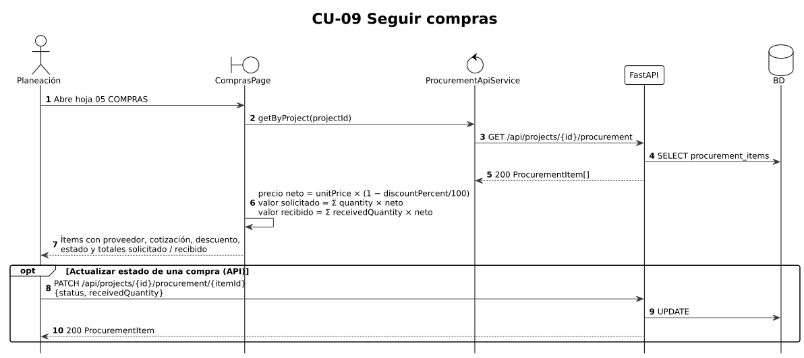

### CU-10 Registrar recepción de materiales

| Campo | Detalle |
|---|---|
| **Actor** | Planeación / almacén |
| **Objetivo** | Dejar constancia de lo recibido frente a lo solicitado, con lote e incidencias. |
| **Precondiciones** | Existen compras del proyecto. |
| **Flujo principal** | 1. El usuario abre la hoja 06. 2. El sistema consulta `GET /projects/{id}/reception`. 3. El sistema muestra lote, cantidad solicitada y recibida, fecha, estado y nota de incidencia. |
| **Flujos alternos** | 3a. Registrar una llegada por API: `PATCH` con `receivedQuantity`, `receivedDate`, `status` e `incidentNote`. |
| **Postcondiciones** | Recepción actualizada. |
| **Reglas / notas** | `receivedDate = null` mientras el material no llega. |

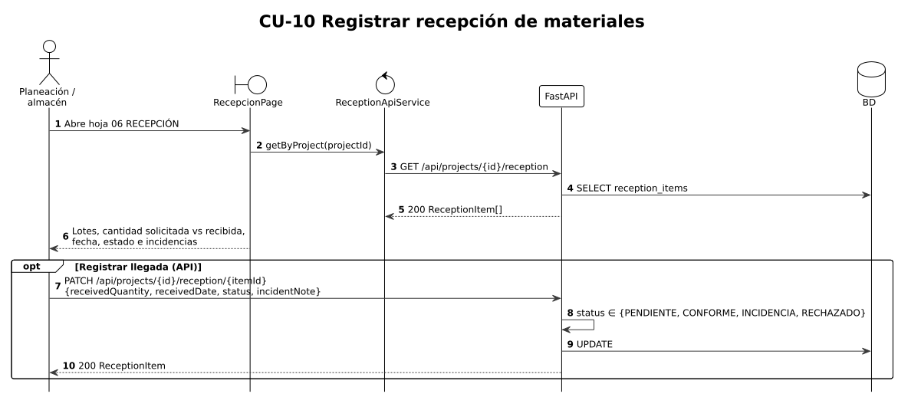

### CU-11 Seguir fabricación y ensamble

| Campo | Detalle |
|---|---|
| **Actor** | Planeación |
| **Objetivo** | Ver el avance de las actividades de taller y de los conjuntos de ensamble con sus dependencias. |
| **Precondiciones** | Proyecto abierto. |
| **Flujo principal** | 1. Hoja 07: el sistema consulta `GET /projects/{id}/fabricacion` y muestra etapa, descripción, responsable, estado, % de avance y fecha objetivo. 2. Hoja 08: el sistema consulta `GET /projects/{id}/ensamble` y muestra los conjuntos, sus dependencias (`dependsOn`) y bloqueos. |
| **Flujos alternos** | 1a / 2a. Actualizar avance o estado por API. |
| **Postcondiciones** | Alimenta el avance del CICLO II (CU-16); los conjuntos BLOQUEADOS aparecen como bloqueos. |
| **Reglas / notas** | El % de avance es visual, no una medición de tiempo real (RE-016 a RE-018 fueron retirados). |

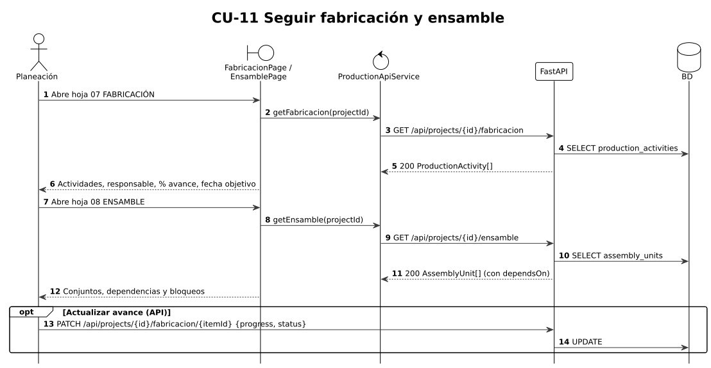

### CU-12 Seguir instalación y puesta en marcha

| Campo | Detalle |
|---|---|
| **Actor** | Planeación |
| **Objetivo** | Seguir la instalación en sitio, el cableado, la programación del controlador y las pruebas. |
| **Precondiciones** | Proyecto abierto. |
| **Flujo principal** | 1. El usuario abre una hoja del CICLO III. 2. El sistema consulta el endpoint correspondiente (`instalacion`, `cableado`, `programacion`, `pruebas`). 3. El sistema muestra actividades con prerrequisitos, circuitos con calibre y control de calidad pendiente, hitos de programación con bloqueos, o protocolos de prueba con su resultado. |
| **Flujos alternos** | 3a. Registrar un resultado de prueba o el avance por API. |
| **Postcondiciones** | La instalación alimenta el avance del CICLO III; las pruebas APROBADAS alimentan los indicadores; los hitos y bloqueos de programación aparecen en el reporte de avance. |
| **Reglas / notas** | Las evidencias de prueba son referencias (`evidenceRef`), sin subida de archivos. |

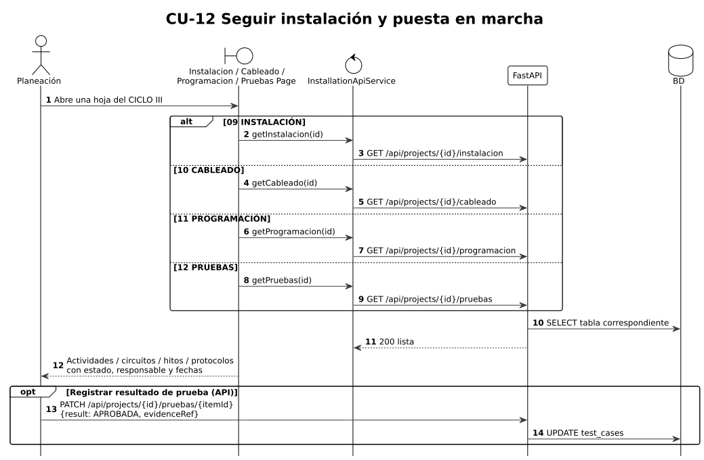

### CU-13 Parametrizar costos del proyecto

| Campo | Detalle |
|---|---|
| **Actor** | Analista financiero |
| **Objetivo** | Definir costos fijos asignados, variables, indirectos y el % de ganancia. |
| **Precondiciones** | El proyecto existe. |
| **Flujo principal** | 1. El analista consulta `GET /projects/{id}/cost-inputs`. 2. Ajusta los valores. 3. Envía `PUT /projects/{id}/cost-inputs`. 4. El sistema crea o actualiza el registro y responde con los valores guardados. |
| **Flujos alternos** | 1a. Sin registro previo: el API devuelve todos los valores en 0. 3a. Tipos inválidos: **422**. |
| **Postcondiciones** | El siguiente reporte de costos usa los nuevos parámetros (RE-026). |
| **Reglas / notas** | La interfaz muestra estos valores dentro de REPORTES › COSTOS; la edición se hace desde `/docs` (Swagger) hasta que exista un formulario. La forma de repartir los costos fijos (RE-020) sigue en caracterización. |

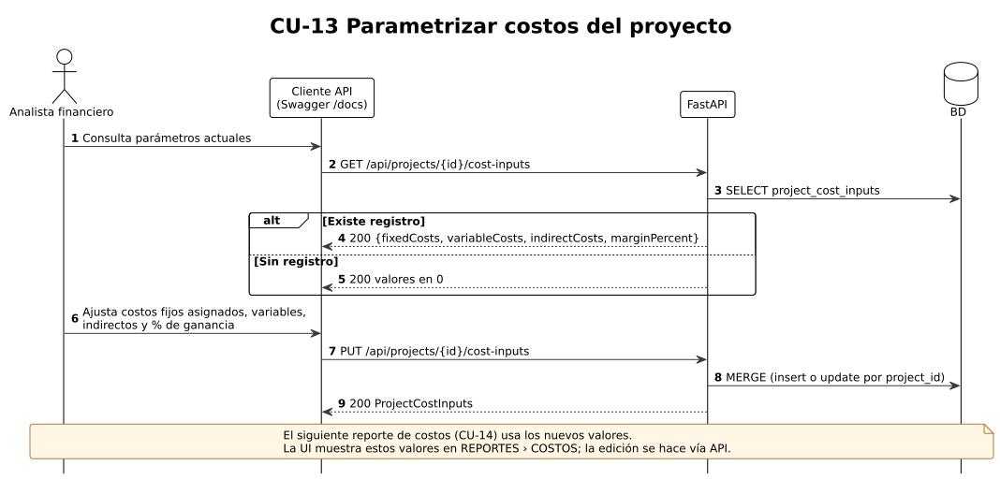

### CU-14 Generar reporte de costos

| Campo | Detalle |
|---|---|
| **Actor** | Analista financiero |
| **Objetivo** | Ver la composición del costo y el valor final estimado (RE-036). |
| **Precondiciones** | Proyecto con BOM, etapas de mano de obra y/o parámetros de costo. |
| **Flujo principal** | 1. El usuario abre REPORTES › 14 COSTOS. 2. El sistema consulta `GET /projects/{id}/reports/costos`. 3. El servidor calcula materiales, mano de obra, costo total, ganancia y valor final. 4. La página muestra el desglose por rubro con su % del total, el costo total, el margen, la ganancia estimada, el valor final y el aviso de comparación con el costo real. |
| **Flujos alternos** | 3a. Sin datos: todos los rubros en 0 y la página muestra el estado vacío. |
| **Postcondiciones** | Ninguna (cálculo al vuelo, no se guarda). |
| **Reglas / notas** | Fórmulas en la [sección 7.3](07-manual-funcional.md#73-fórmulas-de-cálculo). `actualCostAvailable = false` hasta que se implemente RE-027 / RE-038. |

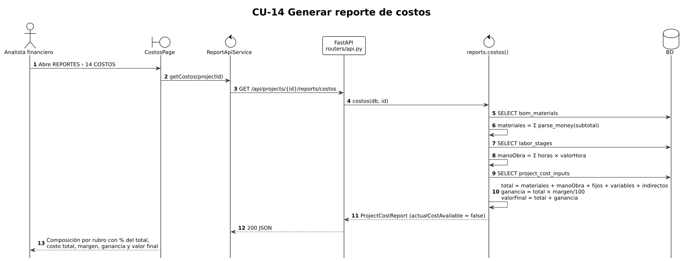

### CU-15 Generar reporte de horas

| Campo | Detalle |
|---|---|
| **Actor** | Analista financiero |
| **Objetivo** | Consolidar la mano de obra proyectada por etapa (RE-037). |
| **Precondiciones** | Etapas de mano de obra registradas (CU-07). |
| **Flujo principal** | 1. El usuario abre REPORTES › 15 HORAS. 2. El sistema consulta `GET /projects/{id}/reports/horas`. 3. La página muestra etapa, horas, valor hora y costo, con el total de horas y el costo total. |
| **Flujos alternos** | 2a. Sin etapas: lista vacía y totales en 0. |
| **Postcondiciones** | Ninguna. |
| **Reglas / notas** | No mide productividad ni tiempo muerto. `capacityStatus = PENDIENTE_DE_CARACTERIZACION`, porque la capacidad disponible (RE-015) aún no está definida con la empresa. |

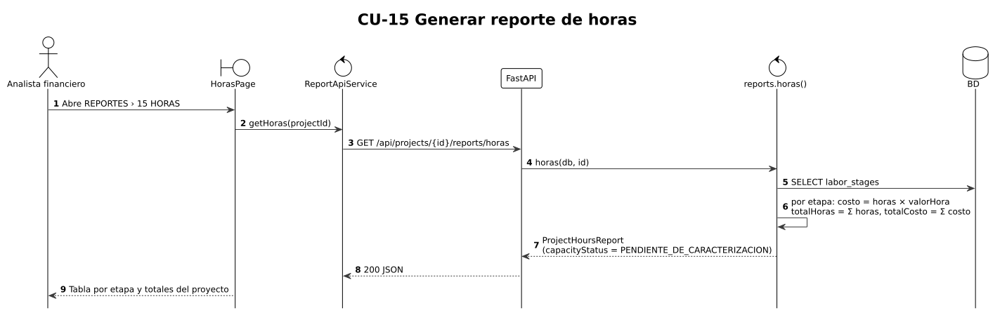

### CU-16 Consultar avance e indicadores

| Campo | Detalle |
|---|---|
| **Actor** | Usuario |
| **Objetivo** | Conocer el avance por ciclo, los hitos, los bloqueos y los indicadores clave del proyecto. |
| **Precondiciones** | Proyecto abierto. |
| **Flujo principal** | 1. Hoja 13 AVANCE: el sistema consulta `reports/avance` y muestra el avance general, el avance por ciclo, los hitos de programación y los bloqueos. 2. Hoja 16 INDICADORES: el sistema consulta `reports/indicadores` y muestra cinco tarjetas: avance general, costo total estimado, horas proyectadas, compras pendientes y pruebas aprobadas. |
| **Flujos alternos** | — |
| **Postcondiciones** | Ninguna. |
| **Reglas / notas** | Cálculo del avance en la [sección 7.3](07-manual-funcional.md#73-fórmulas-de-cálculo). Los indicadores incluyen (`include`) los cálculos de CU-14 y CU-15. |

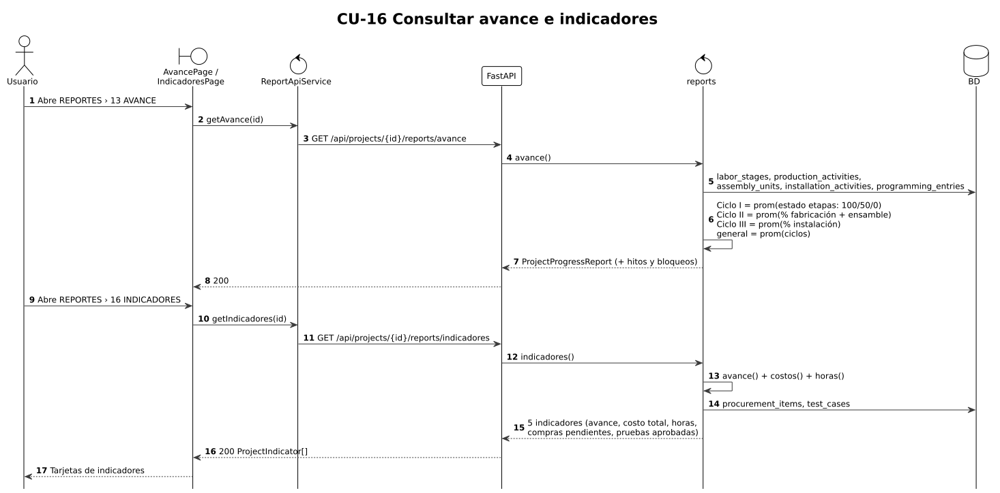

### CU-17 Gestionar notificaciones

| Campo | Detalle |
|---|---|
| **Actor** | Usuario |
| **Objetivo** | Revisar los avisos del sistema y marcarlos como leídos. |
| **Precondiciones** | Sesión iniciada. |
| **Flujo principal** | 1. El usuario abre el panel de notificaciones desde la barra superior. 2. El sistema lista los avisos, resaltando los no leídos. 3. El usuario pulsa un aviso y el sistema lo marca como leído (`PATCH /notifications/{id}/read`). |
| **Flujos alternos** | 3a. **MARCAR TODAS COMO LEÍDAS**: `PATCH /notifications/read-all`. 2a. Sin avisos: «No hay notificaciones». |
| **Postcondiciones** | `read = true` en la base. |
| **Reglas / notas** | Los avisos se crean hoy desde los datos iniciales; no hay generación automática por eventos. |

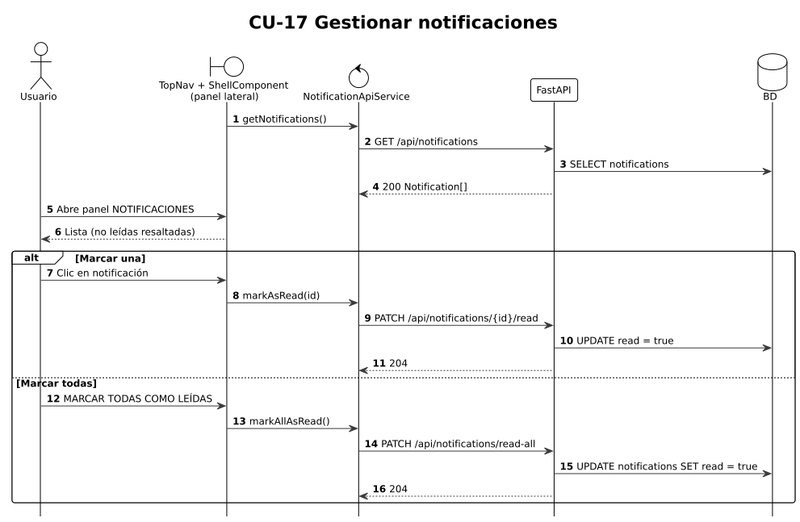

### CU-18 Administrar proyectos

| Campo | Detalle |
|---|---|
| **Actor** | Administrador |
| **Objetivo** | Crear, modificar o eliminar proyectos de costos (RE-001). |
| **Precondiciones** | Acceso al API (`/docs`). |
| **Flujo principal** | 1. El administrador envía `POST /api/projects` con los datos, etapas y `navTemplate`. 2. El sistema valida que el `id` no exista y crea el proyecto con sus etapas. |
| **Flujos alternos** | 2a. `id` duplicado: **409**. 1a. Editar: `PATCH /api/projects/{id}`. 1b. Eliminar: `DELETE /api/projects/{id}`, que borra en cascada todas las colecciones del proyecto. |
| **Postcondiciones** | El proyecto aparece (o desaparece) del portafolio. |
| **Reglas / notas** | El botón **+ NUEVO PROYECTO** del portafolio todavía no está conectado. |

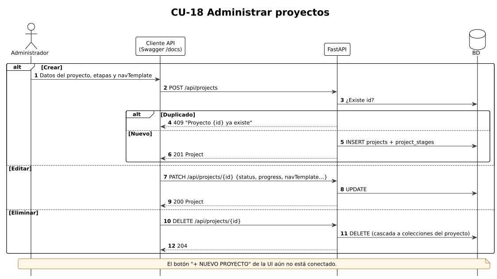

### CU-19 Operar el despliegue

| Campo | Detalle |
|---|---|
| **Actor** | Administrador |
| **Objetivo** | Levantar, respaldar, restaurar y reiniciar el aplicativo. |
| **Precondiciones** | Docker y Docker Compose instalados; carpeta `despliegue/`. |
| **Flujo principal** | 1. `make up`: construye y levanta la base, el backend y el frontend en orden, esperando que cada uno esté sano. 2. El backend crea las tablas y carga los datos de ejemplo si la base está vacía. 3. La aplicación queda disponible en `http://localhost:8080`. |
| **Flujos alternos** | `make backup`, `make restore f=…`, `make reset-db`, `make down`, `make clean`. |
| **Postcondiciones** | Servicios en ejecución; datos persistidos en el volumen `pgdata`. |
| **Reglas / notas** | Detalle en el [Manual de instalación](05-manual-instalacion.md). |

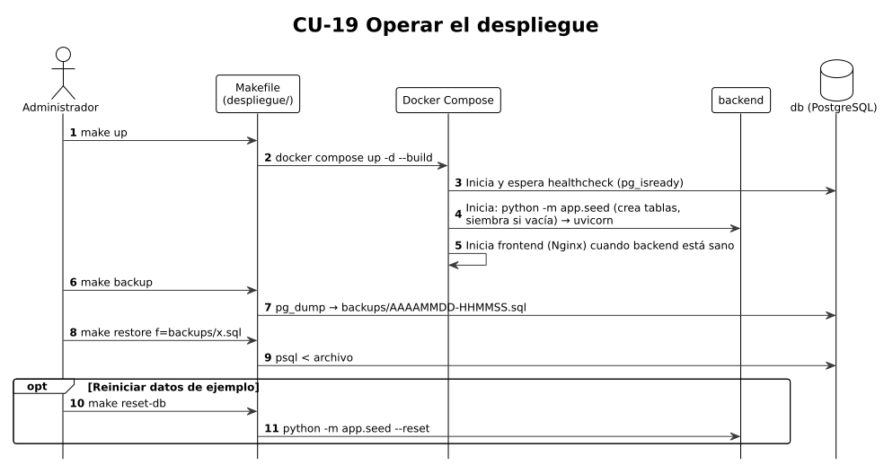
