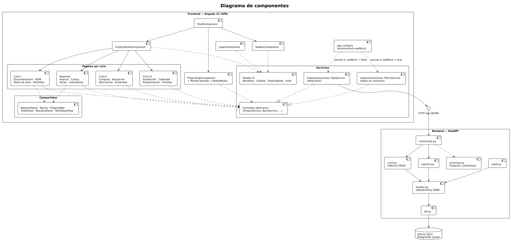
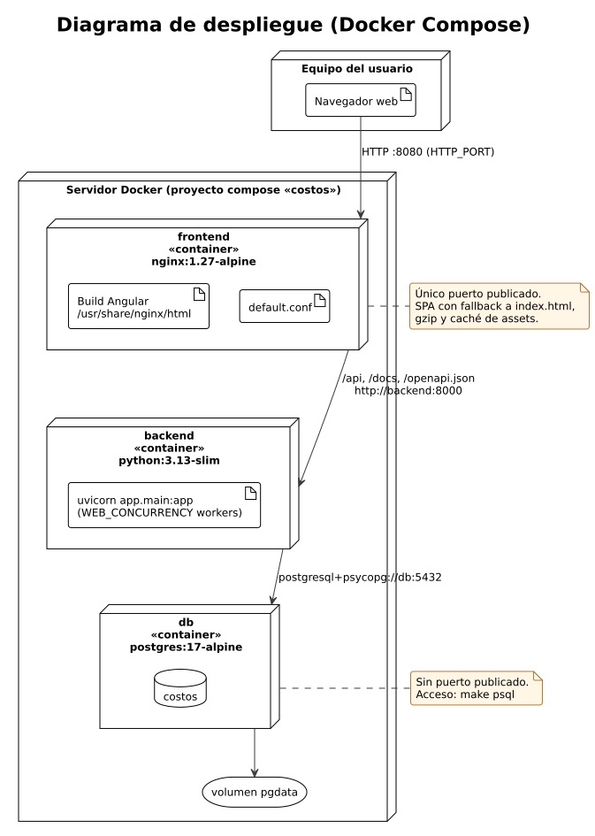
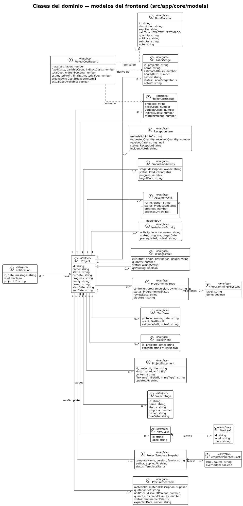
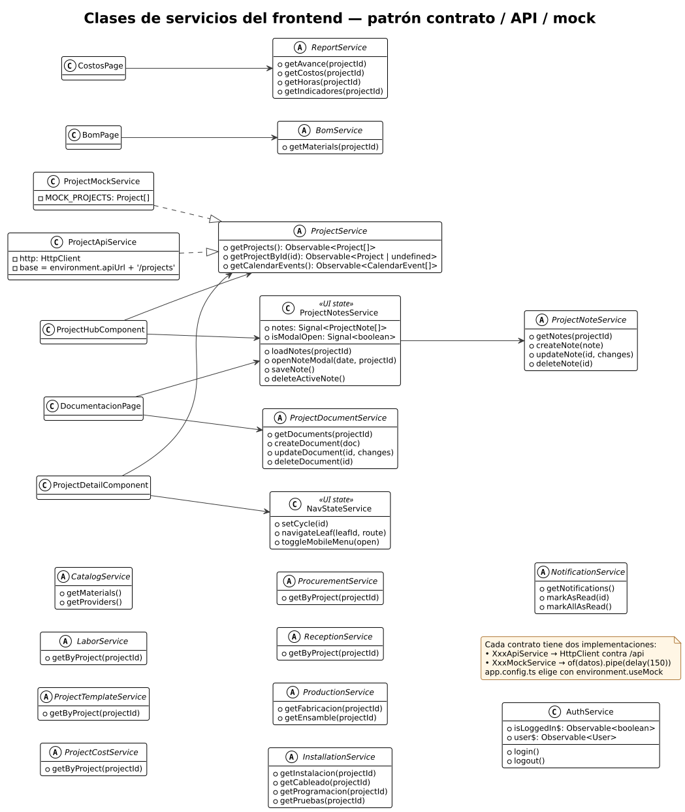
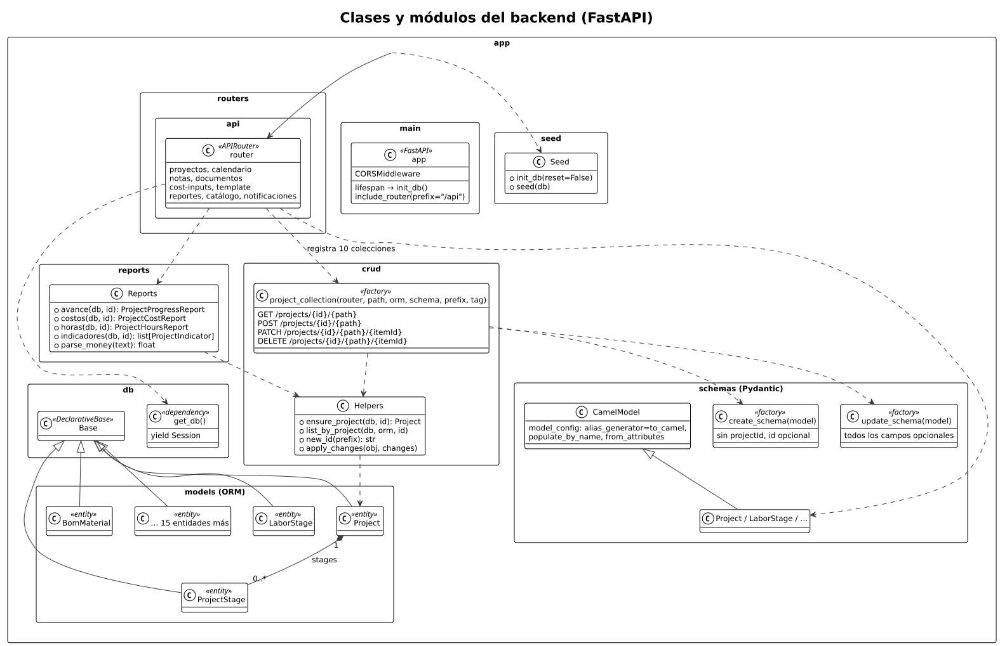
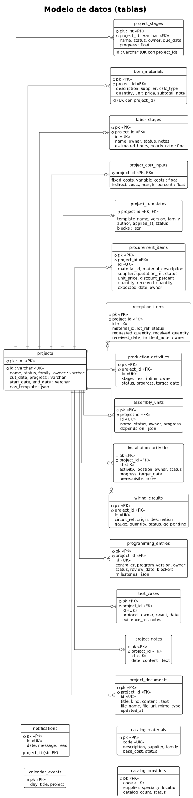
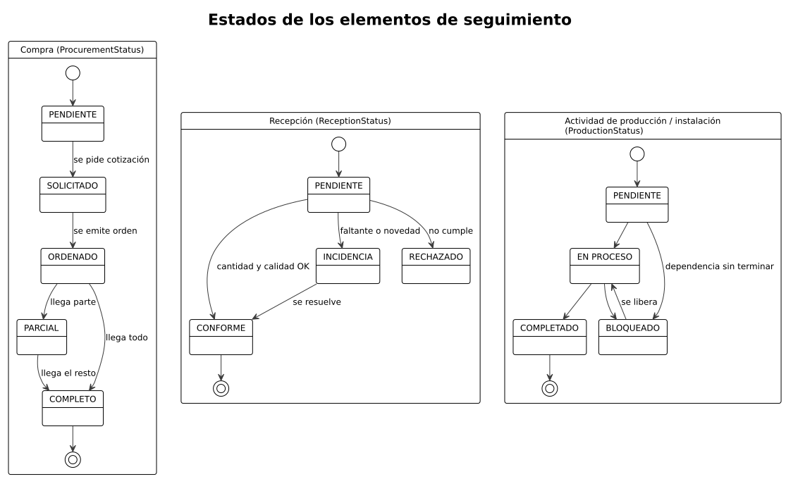

# 3. Arquitectura y diseño

[← Índice](README.md)

## 3.1 Diagrama de componentes



**Frontend.** `ShellComponent` es el marco de la aplicación autenticada: barra superior (`TopNavComponent`), paneles de notificaciones y configuración, y `router-outlet`. Dentro están el portafolio (`ProjectHubComponent`) y el expediente (`ProjectDetailComponent`), cuyas rutas hijas son las páginas de cada ciclo. Las páginas dependen **solo de contratos abstractos**; nunca de `HttpClient` ni de datos locales.

**Backend.** `routers/api.py` declara las rutas. Las diez colecciones por proyecto las genera la fábrica de `crud.py`, y los reportes se calculan en `reports.py`. `schemas.py` define los contratos JSON y `models.py` las tablas.

## 3.2 Diagrama de despliegue



Nginx es el **único punto de entrada**: sirve la SPA y redirige `/api`, `/docs` y `/openapi.json` al backend. Como el front y el API comparten origen, no hace falta CORS. La base de datos no publica puertos.

En **desarrollo** se reemplaza Nginx por el proxy de `ng serve` (`proxy.conf.json`) y PostgreSQL por SQLite.

## 3.3 Clases del dominio (frontend)



`Project` es la raíz del agregado. Todas las colecciones de seguimiento referencian al proyecto con `projectId`. `ProjectCostReport` no se persiste: el servidor lo deriva de `BomMaterial`, `LaborStage` y `ProjectCostInputs`. Los tipos de estado son uniones literales (`'PENDIENTE' | 'EN PROCESO' | …`), validadas también en el backend con `Literal`.

## 3.4 Clases de servicios (frontend)



**Patrón contrato / implementación (inyección de dependencias).**

```ts
// contrato
export abstract class LaborService {
  abstract getByProject(projectId: string): Observable<LaborStage[]>;
}
// app.config.ts
{ provide: LaborService, useClass: environment.useMock ? LaborMockService : LaborApiService }
```

- Cambiar entre datos simulados y reales no toca ninguna página.
- Los mocks devuelven `of(datos).pipe(delay(150))` para simular latencia.
- Los servicios de estado de UI (`ProjectNotesService`, `NavStateService`, `UiStateService`) guardan el estado compartido en *signals*.

## 3.5 Clases y módulos (backend)



Decisiones de diseño:

| Decisión | Motivo |
|---|---|
| Esquemas Pydantic con `alias_generator=to_camel` | El JSON coincide 1:1 con las interfaces TS sin escribir alias a mano; se aceptan camelCase y snake_case. |
| `create_schema` / `update_schema` derivados del esquema base | Un solo lugar define cada recurso; POST quita `projectId` (viene de la URL) y hace `id` opcional; PATCH hace todo opcional. |
| Fábrica `project_collection` | Las diez colecciones tienen el mismo CRUD; se evita repetir ~40 endpoints. |
| PK interna `pk` + `id` de negocio | Orden estable por inserción y los mismos identificadores que usa el frontend. En `bom_materials` y `project_stages` el `id` es único por proyecto. |
| Reportes en servidor | Una sola fuente de verdad para las fórmulas, consumible por otros clientes. |
| `init_db()` en `lifespan` y en `python -m app.seed` | Crea las tablas y carga los datos de ejemplo solo si la base está vacía. En contenedor se ejecuta antes de los workers para evitar carreras entre procesos. |
| `DATABASE_URL` | El mismo código sirve para SQLite (desarrollo) y PostgreSQL (despliegue). |

## 3.6 Modelo de datos



- Todas las tablas de detalle tienen `project_id` como FK a `projects.id` con `ON DELETE CASCADE`.
- `project_cost_inputs` y `project_templates` tienen relación 1:0..1 con el proyecto (PK = `project_id`).
- Las estructuras anidadas sin identidad propia se guardan como JSON: `nav_template`, `blocks`, `milestones` y `depends_on`.
- `notifications.project_id` es opcional y sin FK, porque hay avisos generales. `calendar_events.project` admite texto libre (p. ej., «TODOS LOS PROYECTOS»).
- `catalog_materials` y `catalog_providers` son catálogos globales (RE-007, RE-008), sin relación con el proyecto.

## 3.7 Diagrama de estados



## 3.8 Rutas del frontend

| Ruta | Componente | Hoja |
|---|---|---|
| `/` | LoginComponent | — |
| `/app/proyectos` | ProjectHubComponent | Portafolio |
| `/app/proyectos/:id/documentacion` | DocumentacionPage | 01 |
| `…/bom` · `…/mano-obra` · `…/plantillas` | BomPage · ManoObraPage · PlantillasPage | 02–04 |
| `…/compras` · `…/recepcion` · `…/fabricacion` · `…/ensamble` | Ciclo II | 05–08 |
| `…/instalacion` · `…/cableado` · `…/programacion` · `…/pruebas` | Ciclo III | 09–12 |
| `…/avance` · `…/costos` · `…/horas` · `…/indicadores` | Reportes | 13–16 |
| `…/datos` · `…/usuarios` · `…/permisos` | Configuración (marcadores) | 17–19 |
| `**` | redirige a `/` | — |

## 3.9 Calidad

- **Pruebas del backend** (`make test`): 11 pruebas que cubren todos los GET que usa el frontend, la forma camelCase, los 404, los valores por defecto, las fórmulas de costos y avance, el CRUD de notas y documentos, las notificaciones, la validación 422 y el borrado en cascada (con `PRAGMA foreign_keys=ON` en SQLite).
- **Accesibilidad**: tablas con `caption`, `aria-label` en botones de ícono, y estados indicados con texto (sellos) además del color.
- **Seguridad**: Markdown sanitizado con DOMPurify; contenedor del backend con usuario sin privilegios; base sin puertos expuestos; cabeceras `X-Content-Type-Options`, `X-Frame-Options` y `Referrer-Policy` en Nginx. *Pendiente:* autenticación real y HTTPS.
