# 6. Manual de usuario

[← Índice](README.md)

Este manual explica cómo usar **Costos Industrial** desde el navegador. Las capturas corresponden a los datos de ejemplo, proyecto *PRY-2024-089 — Tablero Línea Extrusión 04*.

> **Navegadores compatibles:** versiones recientes de Chrome, Edge, Firefox o Safari. La interfaz se adapta a pantallas móviles: en móvil, el menú de ciclos se abre con el botón ☰.

## 6.1 Ingreso

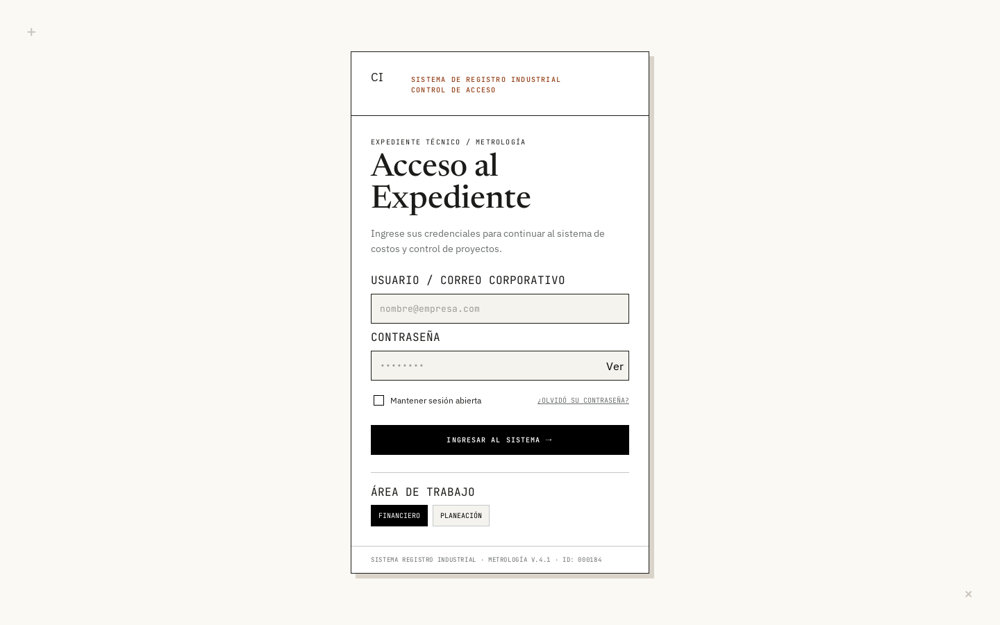

1. Abre la dirección del aplicativo (p. ej., `http://localhost:8080`).
2. Escribe tu correo y contraseña. El ícono del ojo muestra u oculta la contraseña.
3. Pulsa **INGRESAR AL SISTEMA →**.

> En esta versión el ingreso es de demostración: acepta cualquier dato y siempre entra como *Andrea M. — Financiero*.

## 6.2 Elementos comunes

| Elemento | Ubicación | Uso |
|---|---|---|
| Logotipo **CI COSTOS / INDUSTRIAL** | Arriba a la izquierda | Identifica el aplicativo |
| Título de contexto | Barra superior | Muestra la sección actual y, dentro de un expediente, el nombre del proyecto |
| ✉ Notificaciones | Arriba a la derecha | Abre el panel de avisos (ver 6.7) |
| Avatar (AM) | Arriba a la derecha | Menú de usuario: configuración y **CERRAR SESIÓN** |
| **← VOLVER AL PORTAFOLIO** | Dentro de un expediente | Regresa a la lista de proyectos |
| Sellos de estado | Tablas y tarjetas | EN EJECUCIÓN, PENDIENTE, COMPLETADO, BLOQUEADO… (el texto siempre acompaña al color) |
| Notas tipo papel kraft | Tablas | Observaciones, criterios de estimación o avisos |

## 6.3 Portafolio de proyectos

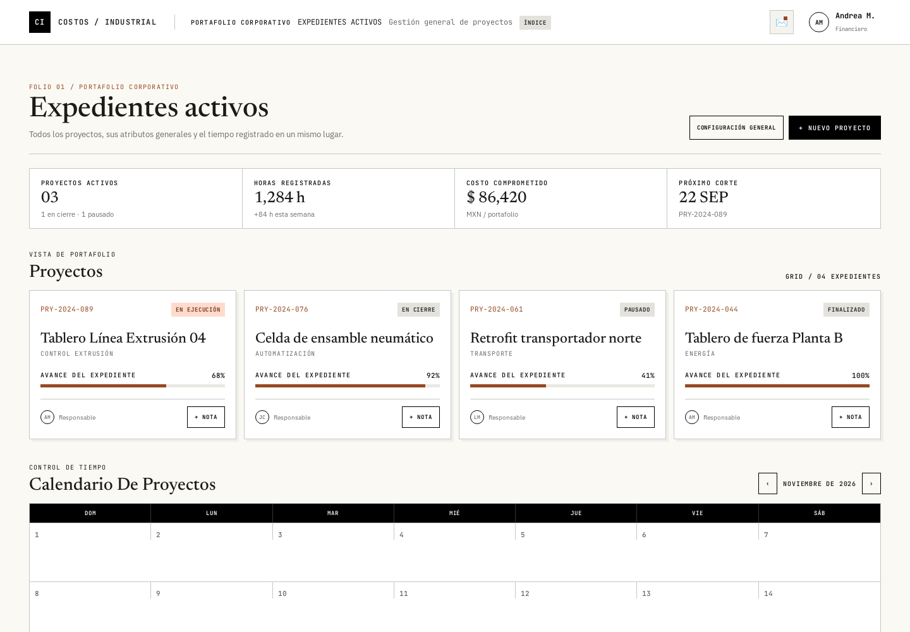

- **Franja de resumen**: proyectos activos, horas registradas, costo comprometido y próximo corte. *(Valores ilustrativos en esta versión.)*
- **Tarjetas de proyecto**: código, estado, nombre, familia, avance del expediente y responsable.
  - Clic en la tarjeta: abre el expediente.
  - **+ NOTA**: agrega una nota rápida al proyecto sin abrirlo.
- **Calendario de proyectos**: hitos del mes (cortes de costos, revisiones, entregas). Usa **‹ ›** para cambiar de mes y haz clic en un evento para abrir su proyecto.

## 6.4 El expediente de un proyecto

Dentro de un proyecto, la barra negra muestra los **ciclos** y la barra gris las **hojas** del ciclo elegido:

| Ciclo | Hojas |
|---|---|
| CICLO I — Ingeniería & estimación | 01 Notas & documentación · 02 Lista de materiales / BOM · 03 Mano de obra & etapas · 04 Plantillas base |
| CICLO II — Taller & producción | 05 Compras · 06 Recepción de materiales · 07 Fabricación · 08 Ensamble |
| CICLO III — Instalación & puesta en marcha | 09 Instalación · 10 Cableado · 11 Programación · 12 Pruebas |
| REPORTES — Reportes & control | 13 Avance · 14 Costos · 15 Horas · 16 Indicadores |
| CONFIGURACIÓN | 17 Datos · 18 Usuarios · 19 Permisos *(en construcción)* |

> Si abres una hoja con un enlace directo, el menú puede seguir resaltando CICLO I › 01. El contenido que se muestra sí es el correcto.

### 01 · Notas & documentación

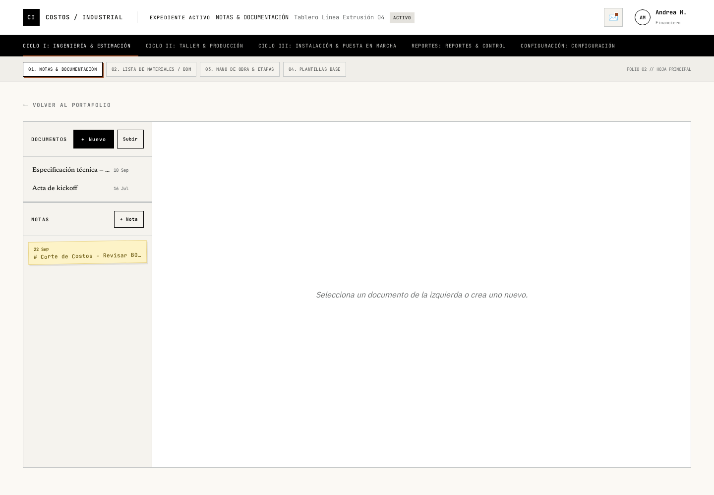

**Documentos**

1. **+ Nuevo** abre el editor. Escribe un título y el contenido en Markdown (`# título`, `- lista`, `**negrita**`, `- [ ] tarea`).
2. Alterna entre **edición** y **vista previa** para ver el documento con formato.
3. Pulsa **Guardar**. El documento aparece en la lista con su fecha de actualización.
4. Para editarlo, selecciónalo en la lista. Para borrarlo, usa el ícono de eliminar junto a su nombre.
5. **Subir** adjunta un Word o Excel como referencia. *(En esta versión el archivo se abre solo en la sesión actual; queda registrado su nombre.)*

**Notas**

1. **+ Nota** crea una nota con la fecha de hoy. Clic en una nota existente para abrirla.
2. En el modal, ajusta la fecha y el contenido, y pulsa **Guardar**.
3. **Eliminar** borra la nota. Guardar una nota vacía también la elimina.

### 02 · Lista de materiales (BOM)

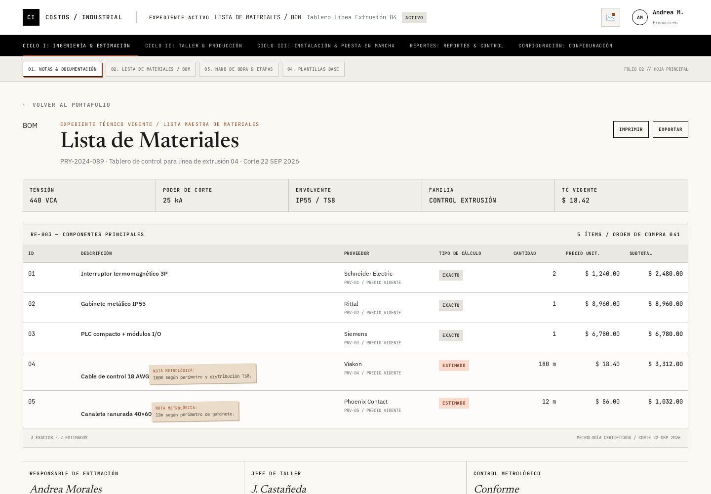

Tabla de componentes con descripción, proveedor, **tipo de cálculo**, cantidad, precio unitario y subtotal.

- **EXACTO**: cantidad conocida (p. ej., 2 interruptores).
- **ESTIMADO**: cantidad aproximada; la fila se resalta y muestra la **nota metrológica** con el criterio (p. ej., «180 m según perímetro y distribución TS8»).

### 03 · Mano de obra & etapas

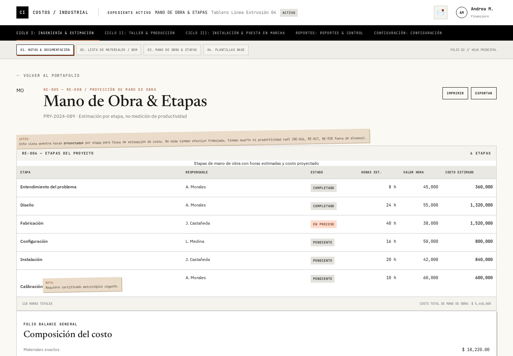

Para cada etapa: responsable, estado, horas estimadas, valor hora y **costo estimado** (horas × valor hora). Al pie aparecen las horas totales y el costo total de mano de obra. Debajo, el panel **Composición del costo** resume los rubros del proyecto.

> Las horas son **proyectadas** para estimar el costo. No miden tiempo trabajado ni productividad.

### 04 · Plantillas base

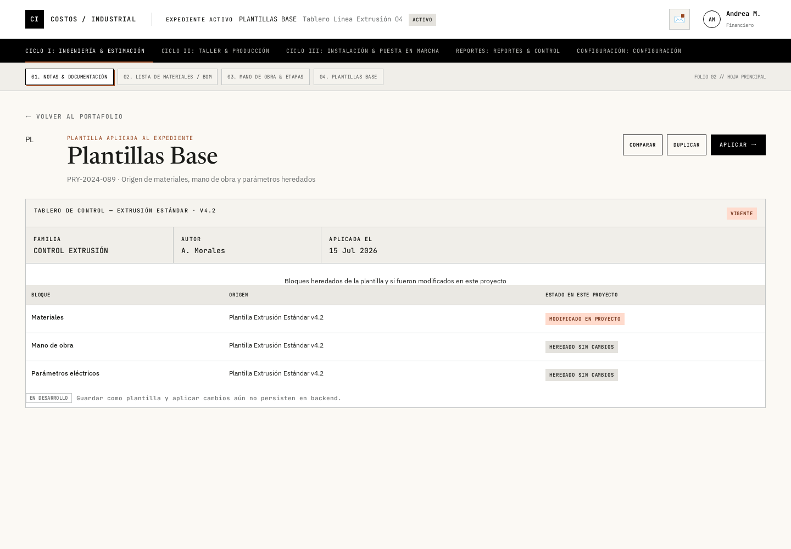

Muestra la plantilla de tablero aplicada (nombre, versión, familia, autor, fecha, estado) y los bloques heredados: materiales, mano de obra y parámetros eléctricos. Cada bloque indica si el proyecto lo **modificó** respecto a la plantilla.

### 05 · Compras

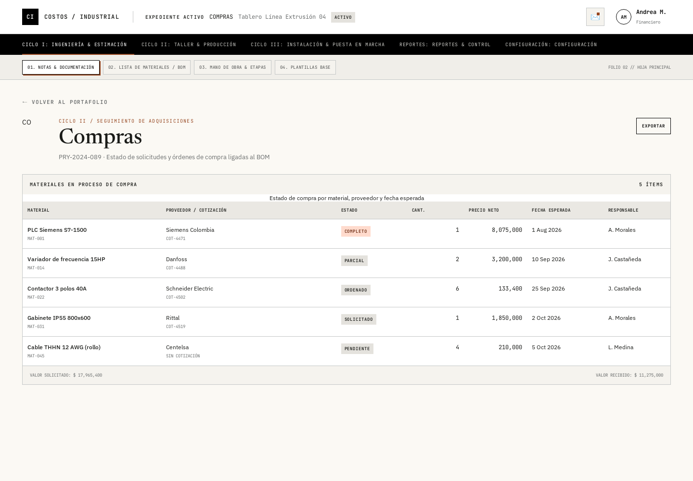

Ítems de compra con material, proveedor y referencia de cotización, estado, cantidad, **precio neto** (precio unitario con el descuento del proveedor ya aplicado), fecha esperada y responsable. También se comparan el **valor solicitado** y el **valor recibido**.

### 06 · Recepción de materiales

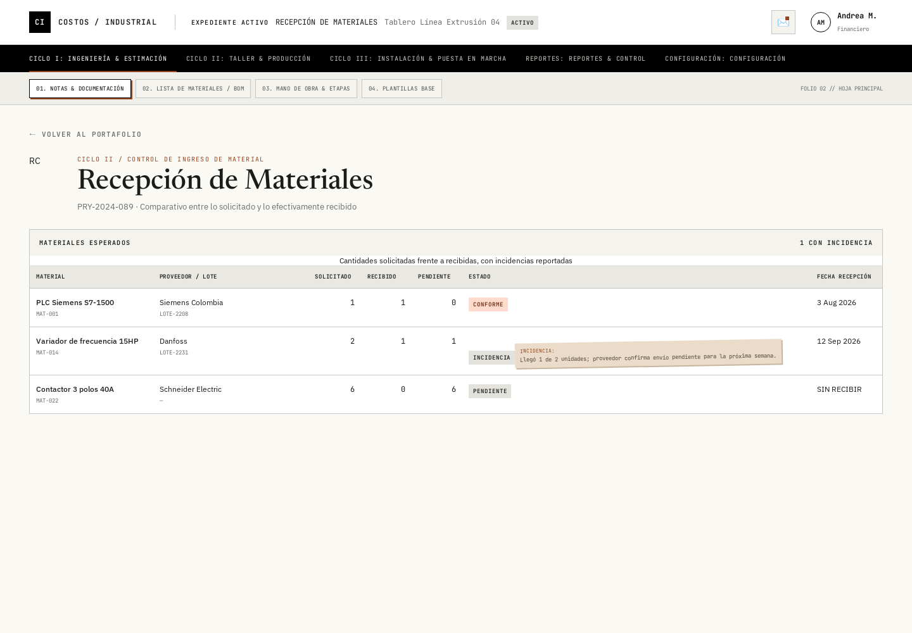

Lotes recibidos frente a lo solicitado, fecha de llegada y estado (CONFORME, INCIDENCIA, RECHAZADO, PENDIENTE). Las incidencias muestran su explicación.

### 07 · Fabricación y 08 · Ensamble

| Fabricación | Ensamble |
|---|---|
| 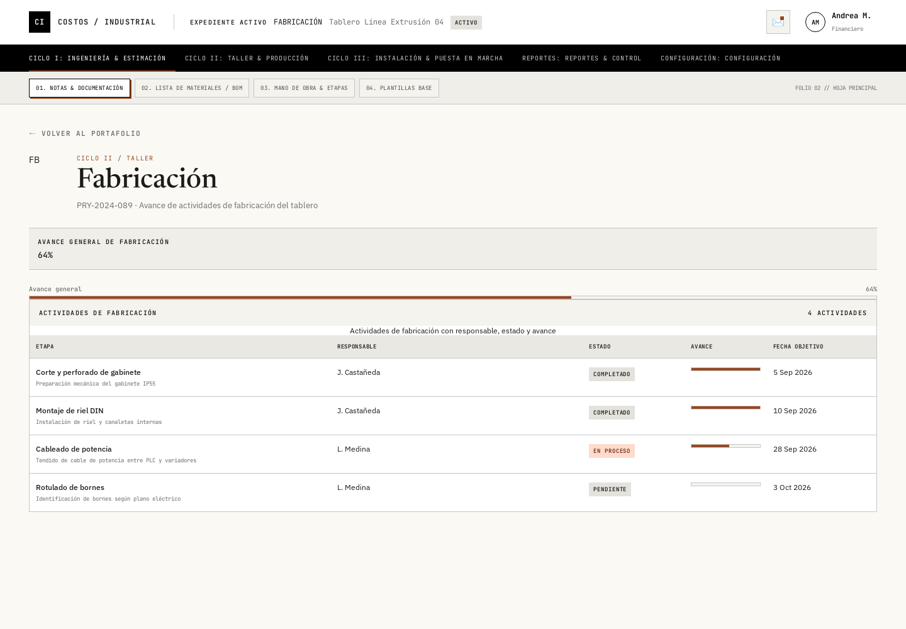 | 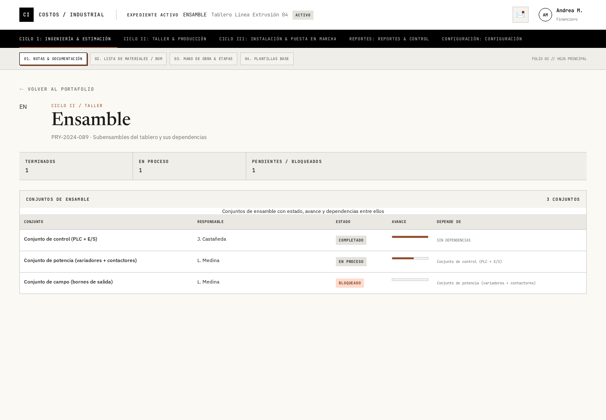 |

- **Fabricación**: actividades de taller con responsable, estado, % de avance y fecha objetivo.
- **Ensamble**: conjuntos con sus **dependencias**. Un conjunto queda BLOQUEADO mientras el anterior no termina.

### 09 – 12 · Instalación, cableado, programación y pruebas

| Instalación | Cableado |
|---|---|
| 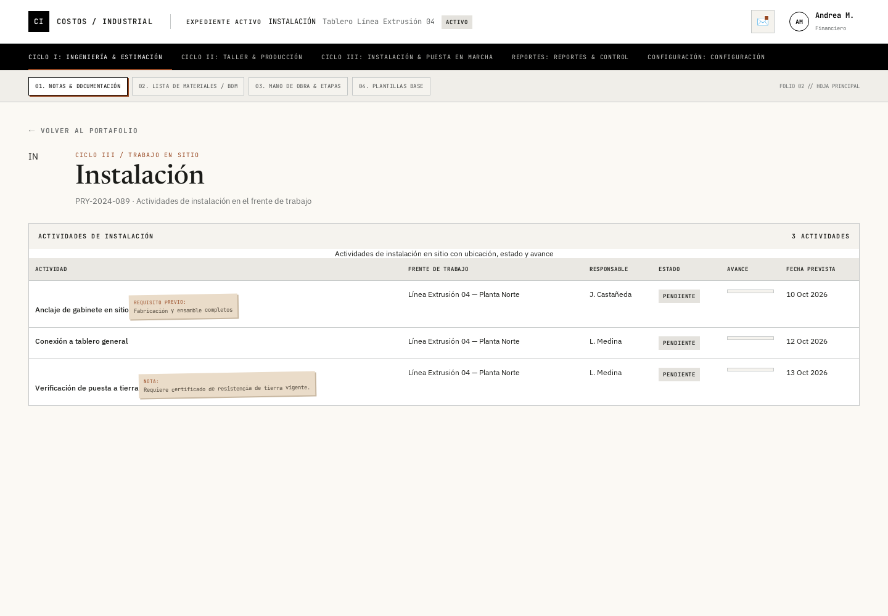 | 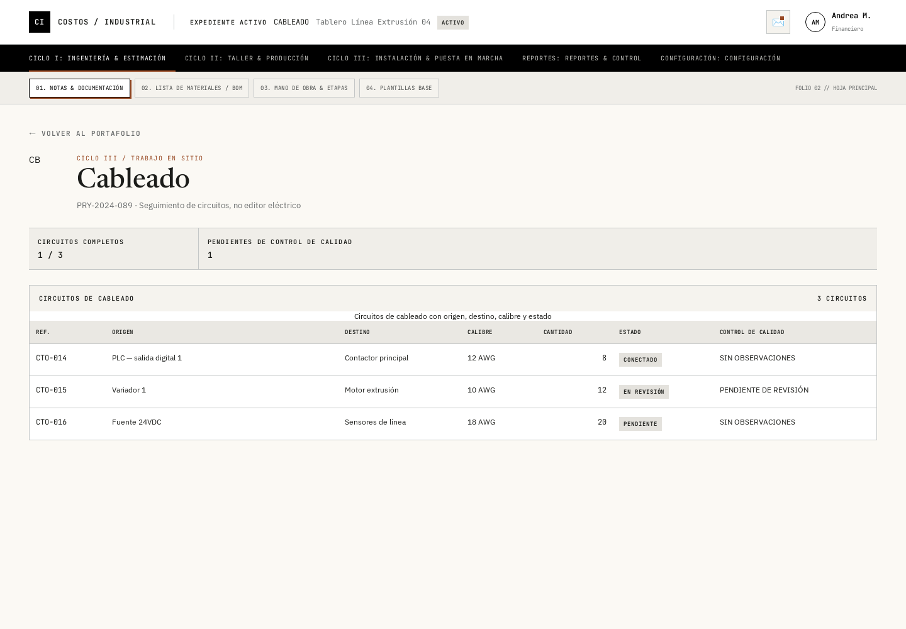 |
| **Programación** | **Pruebas** |
| 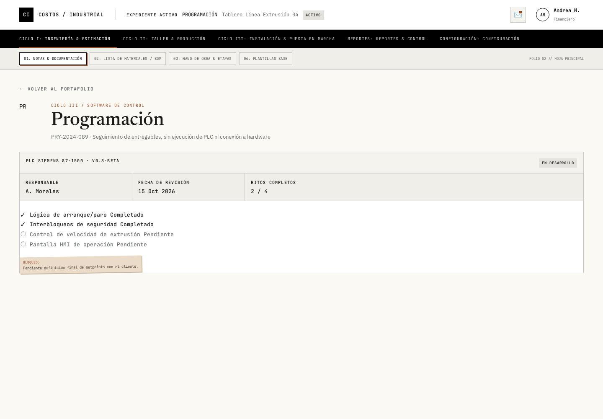 | 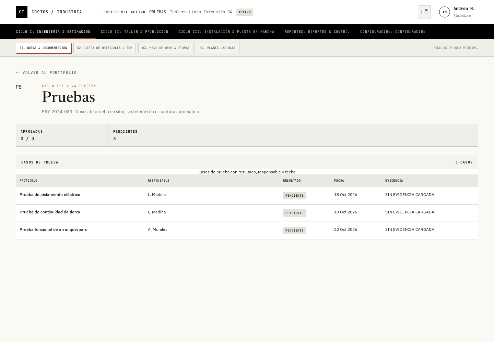 |

- **Instalación**: actividades en sitio, frente de trabajo, prerrequisitos y notas.
- **Cableado**: circuitos con origen, destino, calibre, cantidad, estado y si está pendiente de control de calidad.
- **Programación**: controlador, versión del programa, fecha de revisión, hitos (✓ / ○) y bloqueos.
- **Pruebas**: protocolos con responsable, fecha y resultado (APROBADA, FALLIDA, CON OBSERVACIONES, PENDIENTE).

### 13 · Avance del proyecto

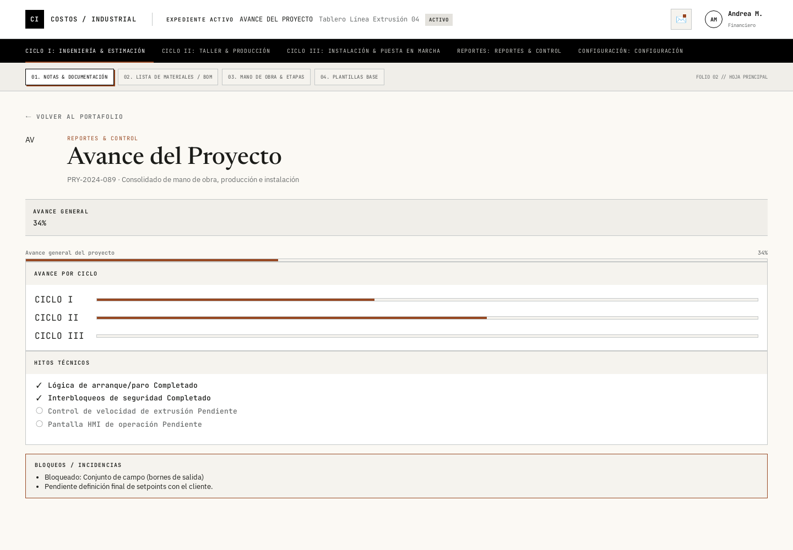

Avance general, avance por ciclo (I, II, III), hitos técnicos y **bloqueos / incidencias** que requieren atención.

### 14 · Costos

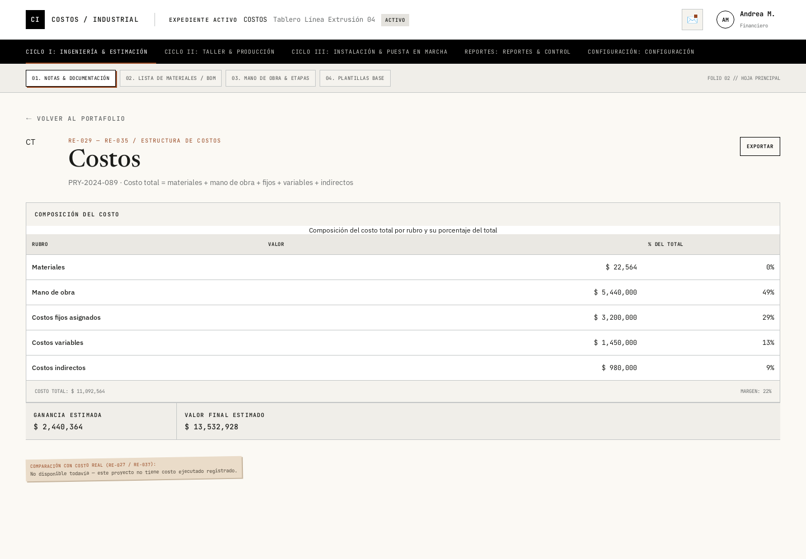

1. **Composición del costo**: materiales, mano de obra, costos fijos asignados, variables e indirectos, con su valor y su % del total.
2. **Costo total** y **margen** (%).
3. **Ganancia estimada** y **valor final estimado**.
4. Aviso de **comparación con el costo real**: aparecerá cuando se registren costos ejecutados.

### 15 · Horas

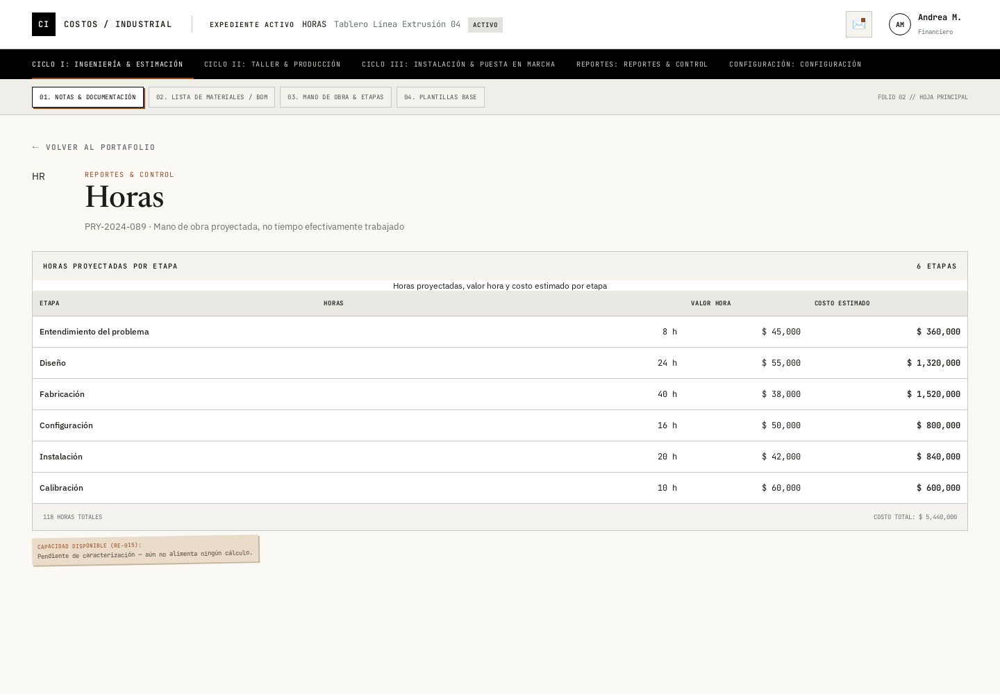

Reporte de mano de obra proyectada: etapa, horas, valor hora y costo, con totales. Muestra que la capacidad disponible de la empresa está *pendiente de caracterización*.

### 16 · Indicadores

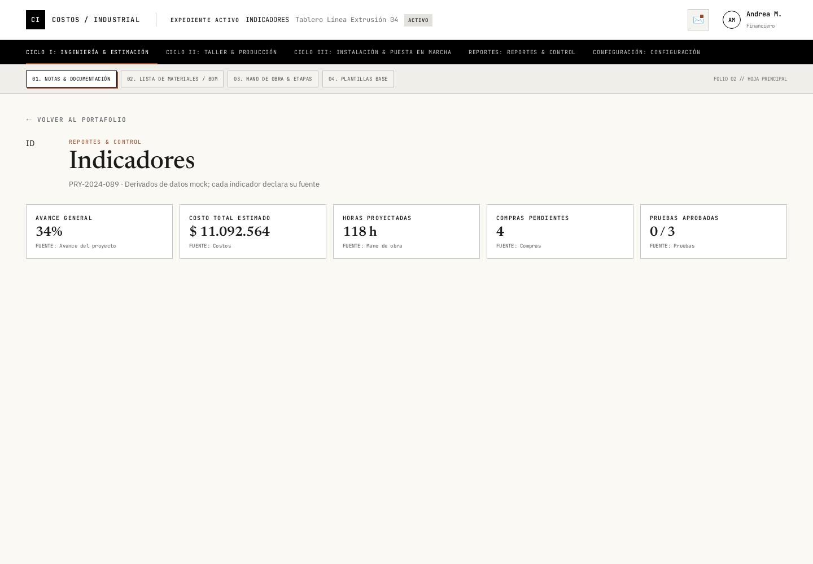

Cinco indicadores del proyecto: avance general, costo total estimado, horas proyectadas, compras pendientes y pruebas aprobadas (aprobadas / total). Cada uno indica de qué hoja sale.

## 6.5 Cambiar parámetros de costo y datos de seguimiento

En esta versión, varias hojas son de **consulta**. Para modificar datos (BOM, etapas, compras, recepción, avance, resultados de pruebas, parámetros de costo) se usa la consola del API:

1. Abre `http://<servidor>/docs`.
2. Busca la operación (p. ej., **PUT /api/projects/{project_id}/cost-inputs**) y pulsa **Try it out**.
3. Escribe el código del proyecto y el cuerpo JSON:
   ```json
   { "projectId": "PRY-2024-089", "fixedCosts": 3500000, "variableCosts": 1450000,
     "indirectCosts": 980000, "marginPercent": 25 }
   ```
4. Pulsa **Execute** y recarga la hoja en el aplicativo: los reportes se recalculan al instante.

Ejemplos de cuerpos para cada recurso en la [Referencia del API](04-referencia-api.md).

## 6.6 Cerrar sesión

Clic en el avatar → **CERRAR SESIÓN**.

## 6.7 Notificaciones

1. Pulsa ✉ en la barra superior.
2. Los avisos **no leídos** aparecen resaltados, con fecha y proyecto.
3. Clic en un aviso lo marca como leído; **MARCAR TODAS COMO LEÍDAS** marca todos.

## 6.8 Preguntas frecuentes

| Pregunta | Respuesta |
|---|---|
| ¿Por qué un rubro aparece en 0 %? | Su valor es muy pequeño frente al total (p. ej., materiales frente a mano de obra) o el proyecto no tiene datos de ese rubro. |
| ¿Por qué un proyecto no muestra datos en algunas hojas? | Solo tiene registros en las etapas que ha alcanzado. Los datos de ejemplo están completos solo para PRY-2024-089. |
| ¿EXPORTAR / IMPRIMIR / NUEVO PROYECTO no hacen nada? | Están previstos para una versión siguiente. Para imprimir, usa la impresión del navegador (Ctrl + P). |
| ¿Se pierde lo que escribo en documentos y notas? | No. Se guarda en la base de datos al pulsar **Guardar**. |
