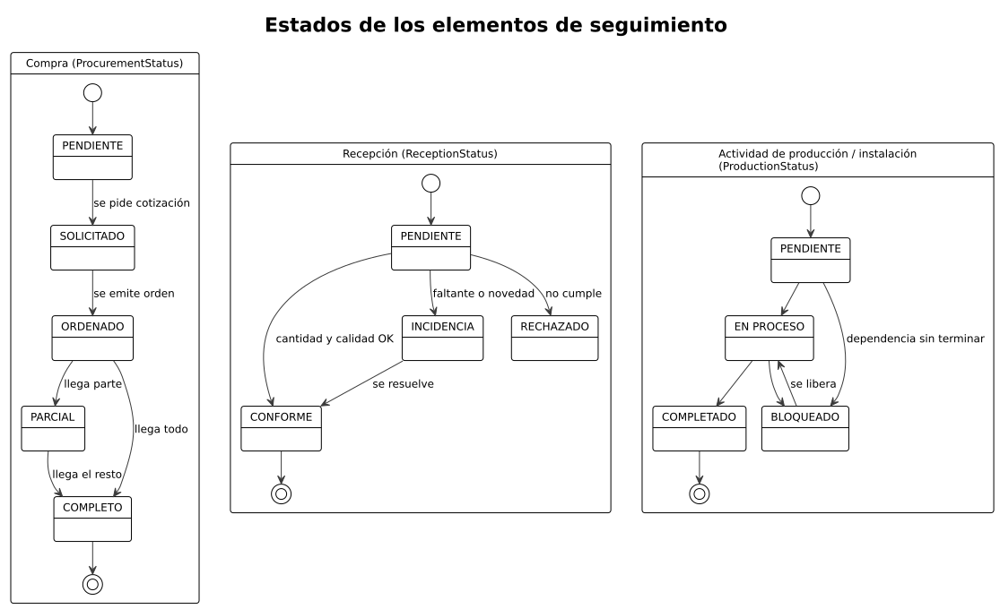

# 7. Manual de funcionalidad

[← Índice](README.md)

Este manual describe **qué hace** el sistema: módulos, reglas de negocio, fórmulas y estados. El *cómo se usa* está en el [Manual de usuario](06-manual-usuario.md).

## 7.1 Mapa funcional

| Módulo | Funciones | Datos que usa | Datos que produce |
|---|---|---|---|
| **Portafolio** | Listar proyectos, calendario de hitos, notas rápidas | projects, calendar_events, project_notes | — |
| **Expediente** | Navegar por ciclos y hojas según el `navTemplate` del proyecto | projects.nav_template | — |
| **Documentación** | Documentos Markdown y adjuntos; notas por fecha | project_documents, project_notes | Documentos y notas |
| **Materiales (BOM)** | Componentes exactos y estimados con proveedor y costo | bom_materials | Costo de materiales |
| **Catálogo** | Materiales y proveedores de referencia (solo API) | catalog_materials, catalog_providers | — |
| **Mano de obra** | Etapas, horas, valor hora, costo por etapa | labor_stages | Costo de mano de obra |
| **Plantillas** | Plantilla de tablero aplicada y bloques modificados | project_templates | — |
| **Compras / recepción** | Precio neto con descuento, cantidades pedidas y recibidas, incidencias | procurement_items, reception_items | Compras pendientes |
| **Producción** | Actividades de fabricación, conjuntos de ensamble y dependencias | production_activities, assembly_units | Avance del ciclo II, bloqueos |
| **Puesta en marcha** | Instalación, cableado, programación, pruebas | installation_activities, wiring_circuits, programming_entries, test_cases | Avance del ciclo III, hitos, pruebas aprobadas |
| **Parámetros de costo** | Costos fijos asignados, variables, indirectos, margen | project_cost_inputs | Insumos del reporte de costos |
| **Reportes** | Costos, horas, avance e indicadores | Todo lo anterior | Reportes (no se guardan) |
| **Notificaciones** | Avisos con estado leído / no leído | notifications | — |

## 7.2 Reglas de negocio

| ID | Regla | Dónde se aplica |
|---|---|---|
| RN-01 | Cada proyecto se identifica con un código único (`PRY-AAAA-NNN`). Un código repetido se rechaza (409). | `POST /projects` |
| RN-02 | Toda la información de seguimiento pertenece a un proyecto; al eliminarlo se elimina todo su detalle (cascada). | BD |
| RN-03 | Un material tiene un tipo de cálculo: **EXACTO** (cantidad determinable) o **ESTIMADO** (aproximación con nota de criterio). | BOM (RE-004, RE-005) |
| RN-04 | El precio neto de compra aplica el descuento del proveedor: `precio × (1 − descuento/100)`. | Compras (RE-009, RE-010) |
| RN-05 | El costo de una etapa de mano de obra es `horas estimadas × valor hora`. | Mano de obra, reportes (RE-014) |
| RN-06 | El costo total suma materiales, mano de obra, costos fijos asignados, variables e indirectos. | Reporte de costos (RE-032) |
| RN-07 | La ganancia se calcula sobre el costo total con el % de margen del proyecto; el valor final es costo total + ganancia. | Reporte de costos (RE-034, RE-035) |
| RN-08 | Si un proyecto no tiene parámetros de costo, se asumen en 0. | `GET cost-inputs`, reportes |
| RN-09 | Los estados solo admiten los valores de su enumerado; cualquier otro se rechaza (422). | Todas las colecciones |
| RN-10 | Una nota vacía no se guarda: guardarla equivale a eliminarla. Hay una nota por proyecto y fecha en el modal. | Notas |
| RN-11 | Al actualizar un documento sin fecha, el servidor registra la fecha y hora actual (UTC). | Documentos |
| RN-12 | Un conjunto de ensamble puede depender de otros (`dependsOn`); si su dependencia no termina, se marca BLOQUEADO y aparece en los bloqueos del avance. | Ensamble, avance |
| RN-13 | Una compra cuenta como pendiente mientras su estado no sea COMPLETO. | Indicadores |
| RN-14 | El reporte de horas no mide productividad ni tiempo muerto (RE-016 a RE-018 retirados). | Horas, mano de obra |
| RN-15 | La comparación entre lo estimado y lo real no está disponible hasta registrar el costo ejecutado (`actualCostAvailable = false`). | Costos (RE-027, RE-038) |

## 7.3 Fórmulas de cálculo

Todas se calculan en el servidor (`backend/app/reports.py`) cada vez que se consulta el reporte.

### Reporte de costos (RE-029 a RE-036)

| Concepto | Fórmula |
|---|---|
| Materiales | `Σ subtotal` de la BOM. El texto con formato (`$ 2,480.00`) se convierte a número. |
| Mano de obra | `Σ (horas estimadas × valor hora)` de las etapas |
| Costo total | `materiales + mano de obra + fijos + variables + indirectos` |
| Ganancia estimada | `costo total × margen / 100` |
| Valor final estimado | `costo total + ganancia estimada` |
| % de cada rubro (UI) | `rubro / costo total × 100` |

**Ejemplo (PRY-2024-089, datos de ejemplo):**

| Rubro | Valor |
|---|---|
| Materiales | 22.564 |
| Mano de obra | 8×45.000 + 24×55.000 + 40×38.000 + 16×50.000 + 20×42.000 + 10×60.000 = **5.440.000** |
| Costos fijos asignados | 3.200.000 |
| Costos variables | 1.450.000 |
| Costos indirectos | 980.000 |
| **Costo total** | **11.092.564** |
| Margen | 22 % |
| Ganancia estimada | 2.440.364,08 |
| **Valor final estimado** | **13.532.928,08** |

### Reporte de horas (RE-037)

`costo etapa = horas × valor hora`; `total horas = Σ horas`; `total costo = Σ costo etapa`. Para PRY-2024-089: **118 h** y **5.440.000**.

### Reporte de avance

| Ciclo | Cálculo |
|---|---|
| CICLO I | Promedio por etapa de mano de obra: COMPLETADO = 100, EN PROCESO = 50, PENDIENTE = 0 |
| CICLO II | Promedio del % de avance de actividades de fabricación y conjuntos de ensamble |
| CICLO III | Promedio del % de avance de actividades de instalación |
| General | Promedio de los tres ciclos (redondeado) |
| Hitos | Hitos de las entradas de programación, con su fecha de revisión |
| Bloqueos | «Bloqueado: {conjunto}» por cada conjunto BLOQUEADO, más el texto de bloqueos de programación |

Ejemplo PRY-2024-089: ciclo I = (100+100+50+0+0+0)/6 = 42; ciclo II = (100+100+55+0+100+60+0)/7 = 59; ciclo III = 0; **general = 34 %**.

### Indicadores

| Indicador | Origen |
|---|---|
| Avance general | Reporte de avance (`%`) |
| Costo total estimado | Reporte de costos, formato `$ 11.092.564` |
| Horas proyectadas | Reporte de horas (`118 h`) |
| Compras pendientes | Compras con estado distinto de COMPLETO |
| Pruebas aprobadas | `aprobadas / total` de las pruebas |

## 7.4 Estados

| Entidad | Estados |
|---|---|
| Etapa de mano de obra | PENDIENTE → EN PROCESO → COMPLETADO |
| Compra | PENDIENTE → SOLICITADO → ORDENADO → PARCIAL → COMPLETO |
| Recepción | PENDIENTE → CONFORME / INCIDENCIA / RECHAZADO |
| Fabricación, ensamble, instalación | PENDIENTE ↔ EN PROCESO → COMPLETADO; BLOQUEADO |
| Circuito de cableado | PENDIENTE → CONECTADO → EN REVISIÓN → APROBADO |
| Programación | PENDIENTE → EN DESARROLLO → EN REVISIÓN → APROBADO |
| Prueba | PENDIENTE → APROBADA / FALLIDA / CON OBSERVACIONES |
| Plantilla | BORRADOR → VIGENTE → HISTÓRICA |

> El sistema valida que el valor pertenezca al enumerado, pero **no** impone el orden de las transiciones; el diagrama describe el flujo esperado del proceso.

## 7.5 Modos de operación del frontend

| Modo | Comando | Datos |
|---|---|---|
| API (por defecto) | `npm start` / `make dev-front` / Docker | Backend FastAPI, persistentes |
| Mock | `make dev-front-mock` (`ng serve --configuration mock`) | En memoria; se pierden al recargar |

## 7.6 Limitaciones conocidas

| # | Limitación | Impacto | Propuesta |
|---|---|---|---|
| L-01 | Autenticación simulada, sin guard de rutas ni roles | Cualquiera con la URL entra | Endpoint `/api/auth/login` con JWT + `canActivate` + roles financiero / planeación |
| L-02 | Formularios de edición solo para documentos y notas | Los demás datos se editan por API | Formularios en cada hoja, reutilizando los endpoints existentes |
| L-03 | Los adjuntos no suben el binario | El archivo no está disponible en otra sesión | Endpoint de subida (multipart) y almacenamiento de objetos |
| L-04 | Los montos de BOM y catálogo son texto con formato (MXN) y los de mano de obra, compras y costos son números (COP) | La suma combina monedas | Unificar moneda y guardar montos como `numeric` |
| L-05 | La franja de resumen del portafolio y el subtítulo de la BOM son texto fijo | No reflejan los datos reales | Calcularlos desde el API |
| L-06 | El menú no se sincroniza al entrar por URL directa | Ciclo y hoja resaltados incorrectos | Sincronizar `NavStateService` con la ruta activa al cargar |
| L-07 | EXPORTAR, IMPRIMIR, NUEVO PROYECTO y las hojas de CONFIGURACIÓN no hacen nada todavía | — | Siguiente iteración |
| L-08 | RE-006, RE-027, RE-028, RE-038 no implementados | Sin tipificación ni calibración | Ver [trazabilidad](08-trazabilidad.md) |
| L-09 | Las notificaciones no se generan por eventos | Solo existen las de ejemplo | Crear avisos al cambiar BOM, compras o recepción |
